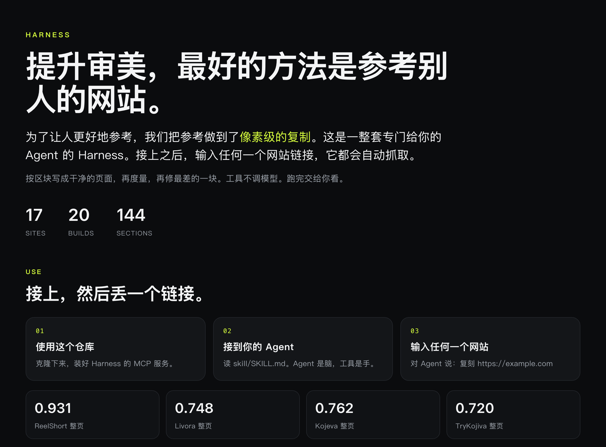
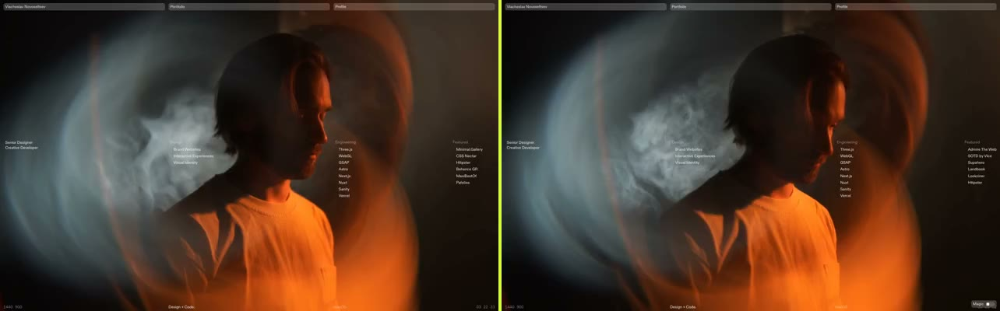
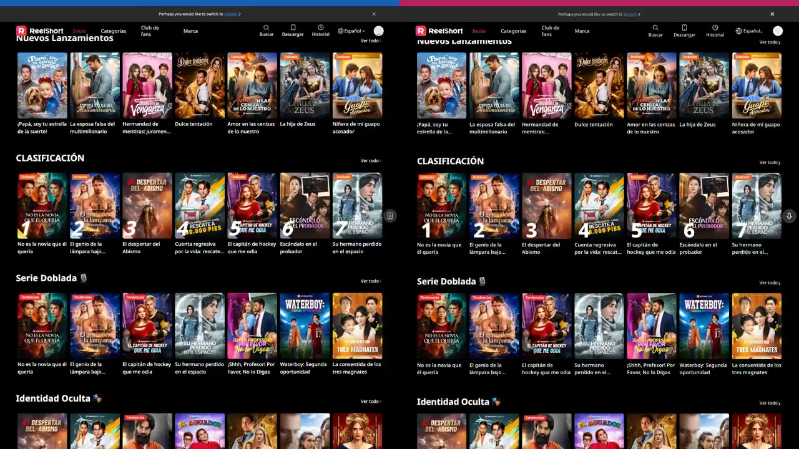
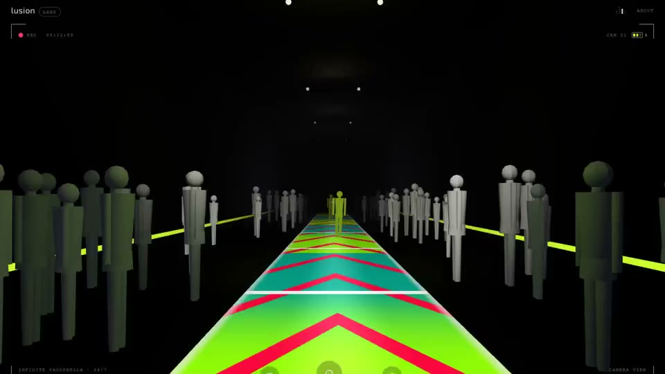
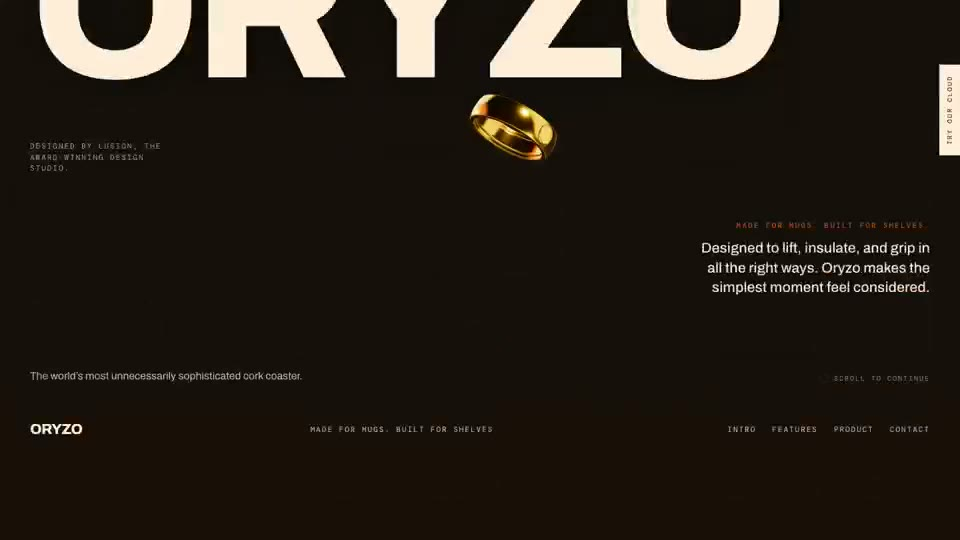
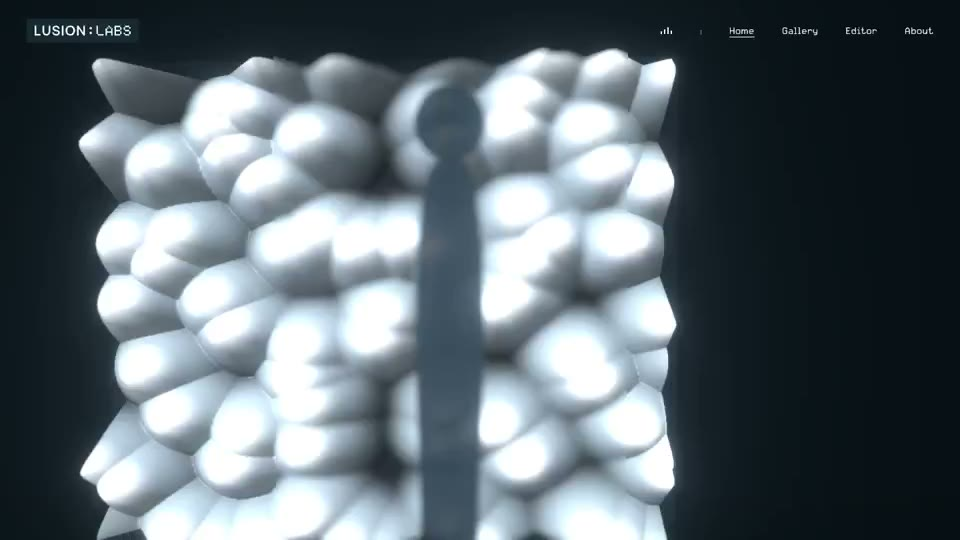

# Harness

<p>
  
</p>

提升审美，最好的方法是参考别人的网站。为了让人更好地参考，我们把参考做到了像素级的复制。Harness 是一整套专门给你的 Agent 的工作流。使用这个仓库，在 Agent 里输入任何一个网站链接，它都会自动抓取。

抓下来之后，按区块写成干净的 Vite + React + Tailwind 页面，再度量，再修最差的一块。工具不调模型。判断和写组件的是你的 Agent。跑完交给你看，状态是 `ready_for_user_review`。验收由你来做。WebGL、canvas、滚动编排画不进静态光栅时，写成残留，留在结果里。

## 复刻效果

左右对照里，左是原站，右是 Harness 复刻出来的页面。获奖站点只有两边都画实了才并排。点进图片看仓库里的视频。

### vshslv

Awwwards Honorable Mention，2026-07-02。Viacheslav Novoseltsev 的作品集。另有 CSS Winner Site of the Day（2025-12-31）和 CSS Nectar Site of the Day（2026-04-09）。轮换的 Featured 名单和浏览器外框，两边会不一样。

<p></p>

[看对照视频](showcase/videos/compare-vshslv.mp4)

### ReelShort

度量对照，整页 SSIM **0.931**，区块合计 0.819，89/89 条静态链接。西语短剧首页。复刻顶上那条语言切换，是抓取时页面自己的状态。

<p></p>

[看对照视频](showcase/videos/compare-reelshort.mp4)

### Livora · SilkGlide

度量对照，整页 SSIM **0.748**。16 个区块，指纹 0，代码约 55KB。首屏对齐。往下两边区块高度不一样，同一帧会错开。

<p></p>

[看对照视频](showcase/videos/compare-livora.mp4)

### Kojeva

度量对照，整页 SSIM **0.762**。10 个区块，其中 3 个残留写在账上。首屏对齐，再往下会错开。

<p></p>

[看对照视频](showcase/videos/compare-kojeva.mp4)

### Infinite Passerella

Awwwards Site of the Day，2022-05-09，7.69/10，Lusion。另有 Developer Award，以及 FWA of the Day（2022-02-25）。画面是复刻的跑道。原站这一次停在加载页，WebGL 没画进对照。

<p></p>

[看视频](showcase/videos/infinite-passerella.mp4)

### ORYZO

Awwwards Site of the Day，2026-04-13，7.86/10，Lusion。这是复刻页的长滚动。原站是滚动编排的 WebGL，存下来的参考图只有一屏。

<p></p>

[看视频](showcase/videos/oryzo.mp4)

### CineShader

Awwwards Honorable Mention，2020-02-14，Lusion Labs。画面是复刻的 Crystalline。原站截图里画布是黑的。

<p></p>

[看视频](showcase/videos/cineshader.mp4)

Everswap 是 Awwwards Site of the Day（2026-06-22）加 Developer Award。仓库里的整页截图没有把 WebGL 山景画出来，所以没有放左右对照。TryKojiva 整页 SSIM 0.7204，区块合计 0.667，记为残留，并排视频在 [compare-trykojiva.mp4](showcase/videos/compare-trykojiva.mp4)。

这四份分数来自 [`delivery/four-reference-sites.md`](delivery/four-reference-sites.md)。那份账用的视觉阈值是 0.72。仓库默认视觉门仍是 SSIM 0.97。分数是度量，不是验收结论。

## 每一个复刻

| 复刻 | 视频 | 说明 |
| --- | --- | --- |
| ReelShort | [滚动](showcase/videos/reelshort.mp4) · [对照](showcase/videos/compare-reelshort.mp4) | 4 区块，整页 0.931 |
| Livora | [滚动](showcase/videos/livora.mp4) · [对照](showcase/videos/compare-livora.mp4) | 16 区块，整页 0.748 |
| Kojeva | [滚动](showcase/videos/kojeva.mp4) · [对照](showcase/videos/compare-kojeva.mp4) | 10 区块，整页 0.762 |
| TryKojiva | [滚动](showcase/videos/trykojiva.mp4) · [对照](showcase/videos/compare-trykojiva.mp4) | 5 区块，整页 0.7204，区块 0.667 残留 |
| FUCH | [滚动](showcase/videos/fuch.mp4) | React + Three.js |
| Muse | [滚动](showcase/videos/muse.mp4) | 10 区块，ai.meta.com/muse |
| Next · from Poke | [滚动](showcase/videos/next-poke.mp4) | 从 Poke 首页长出的 Next 产品页 |
| vshslv | [滚动](showcase/videos/vshslv.mp4) · [对照](showcase/videos/compare-vshslv.mp4) | Awwwards HM，2026-07-02 |
| CineShader | [滚动](showcase/videos/cineshader.mp4) | Awwwards HM，2020-02-14 |
| Infinite Passerella | [滚动](showcase/videos/infinite-passerella.mp4) | Awwwards SOTD，2022-05-09 |
| ORYZO | [滚动](showcase/videos/oryzo.mp4) | Awwwards SOTD，2026-04-13 |
| ORYZO · Pixel | [滚动](showcase/videos/oryzo-pixel.mp4) | 同一站点的短光栅静态页 |
| VARIANT3D | [滚动](showcase/videos/variant3d.mp4) | 14 区块 |
| Longbow | [滚动](showcase/videos/db-longbow.mp4) | 16 区块 |
| Novu | [滚动](showcase/videos/withnovu.mp4) | 5 区块 |
| Pagerie | [滚动](showcase/videos/pagerie.mp4) · [对照](showcase/videos/compare-pagerie.mp4) | 13 区块 |
| Pagerie · The Dorro | [滚动](showcase/videos/pagerie-dorro.mp4) | 11 区块 |
| Pagerie 重建 | [滚动](showcase/videos/pagerie-v4.mp4) | 13 区块 |
| Everswap | [滚动](showcase/videos/everswap.mp4) | SOTD 2026-06-22；整页光栅未画出山景 |
| Sowieso | [滚动](showcase/videos/sowieso.mp4) | 11 区块 |

## 怎么用

1. 使用这个仓库。装好 Python 侧的 MCP 服务。
2. 把 `pwc4` 接到 Agent，让它读 [`skill/SKILL.md`](skill/SKILL.md)。那份 Skill 是整条复刻流程的合同。
3. 对 Agent 说 `复刻 https://example.com`。一次请求走完抓取、分段、写页面、构建、度量、修补和本地预览。部署要另说。

```bash
python -m venv .venv
source .venv/bin/activate
pip install -e .
playwright install chromium
```

仓库根目录有一份 [`.mcp.json`](.mcp.json)，注册的服务名叫 `pwc4`。把 `cwd`、`PYTHONPATH` 换成这台机器上的仓库绝对路径，`python` 指向已经装好依赖的解释器：

```json
{
  "mcpServers": {
    "pwc4": {
      "command": "python",
      "args": ["-m", "mcp_server.server"],
      "cwd": "/absolute/path/to/this-repo",
      "env": {
        "PYTHONPATH": "/absolute/path/to/this-repo"
      }
    }
  }
}
```

Claude Code、Codex，以及任何能读 Skill、能连 stdio MCP 的 Agent，都走这一套。没有单独的克隆 CLI，也没有克隆 API。接上的 Agent 就是运行时。一次请求可以在内部做很多轮工具调用和修补，不用你来拆步骤。

每次运行在沙箱里写 `.pwc/run.json`。换一个网站会换一块干净的沙箱，上一个站的组件不会漏进来。

**这些工具本身不调用任何模型。** 抓取、分段、写文件、执行、截图、构建、诊断，都是确定性的 Python。写代码和判断像不像，由你的 Agent 完成。

## 技术原理

页面在某个断点、某个可见状态下，会画成一张光栅。同一张图可以由很多份源码画出来。所以复刻可以写成干净的 React，再用截图验收。像素级在这里的合同是：约定的断点 × 约定的可见状态，逐区块对齐。

1. **抓取** — `extract_page(url)` 留下不可变的原站证据，发现常见交互，结构不一致时最多重试三次。
2. **分段** — `get_section_plan(source_id)` 按真实区块切开。区块是后来的修补单位。
3. **书写** — 一个 Agent 拿着整页上下文，逐段写 `sections/{namespace}/` 里的干净 JSX。
4. **组装** — `assemble_project(source_id)` 接上 `App.jsx`、路由和 `index.css`。
5. **构建** — `build_project()` 必须产出 `dist/`。
6. **度量** — 按顺序过完整性、关键结构、交互回放、指纹、体积、逐区块视觉。前面的门没开，后面的分数不能盖过去。
7. **修补** — 只修最差的一块。每个断点 × 状态最多五次。然后交给你。

四件事同时成立：

- 每个要求都是一道门。指纹、代码是否干净、体积、视觉，都由工具打分并留下证据。
- 干净和像是两道门。上游写可读组件，下游用 SSIM 对光栅。
- 手不调模型。一个 Agent 当脑。
- 画不下来的写成残留。终端状态只有 `ready_for_user_review` 或 `failed_with_residuals`。

IR 生成（`build_ir`、`run_recognizers`、`generate_code`）是实验路径。默认路径是 Agent 自己写组件，再走度量修补。

产物是 Vite + React + Tailwind 的静态构建。`npm run build` 得到纯静态 `dist/`。

可运行的复刻在 `showcase/products/<name>/`。资源路径是绝对的 `/assets`，要在该目录自己起服务：`npm install`，然后 `npm run preview`。`cineshader` 和 `oryzo-pixel` 是单文件，直接打开里面的 `index.html`。

## 仓库里有什么

```
├─ skill/            # SKILL.md，Harness 的复刻合同
├─ mcp_server/       # pwc4，确定性工具，不调模型
├─ core/             # 抓取与沙箱
├─ templates/        # Vite + React + Tailwind 底稿
├─ showcase/         # 复刻合集、对照图、视频
├─ delivery/         # 四份参考站的度量账
├─ .mcp.json
└─ README.md
```

Harness 不自己维护一套 Agent 循环。脑交给接进来的编码 Agent。抓取、分段、沙箱和度量这些手，是确定性的 Python。
